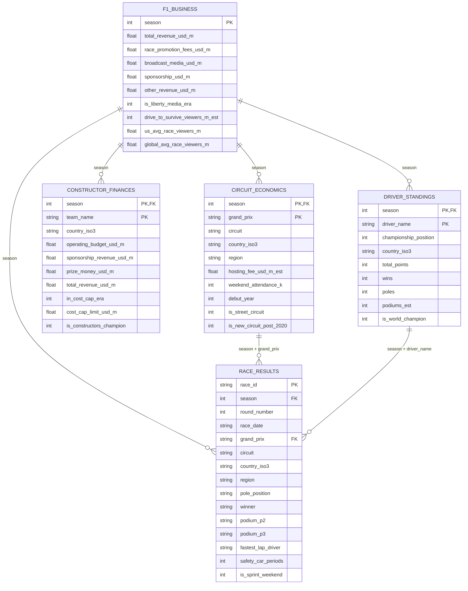

# 🏁 Planejamento Estratégico & Engenharia de BI: F1 Business & Sports Intelligence

Documento de especificação funcional, modelagem dimensional e arquitetura analítica para o dashboard de Business Intelligence da Fórmula 1 (2010 - 2026).

---

## 🎯 1. Objetivo do Projeto

Desenvolver um **Dashboard Executivo e Interativo de BI** em Python (Streamlit, Plotly e DuckDB) containerizado via Docker, permitindo a análise de 17 temporadas da Fórmula 1 sob duas perspectivas complementares:
1. **Visão Corporativa & Financeira:** Analisar o crescimento global do Grupo F1 (Liberty Media), a monetização de circuitos (Hosting Fees), os efeitos de novas mídias (*Drive to Survive*, expansão no mercado norte-americano) e o impacto do teto orçamentário (*Cost Cap*) na sustentabilidade das equipes.
2. **Visão Esportiva & Competitiva:** Avaliar o ROI (Retorno sobre Investimento) das escuderias, a eficiência de conversão de orçamento em pontos e vitórias, e o impacto de traçados de rua vs. autódromos tradicionais.

---

## 🏗️ 2. Arquitetura de Dados & Modelagem Relacional

A base de dados é composta por 5 tabelas relacionais contendo dados históricos de 2010 a 2026.

### 2.1 Diagrama Entidade-Relacionamento (DER)



---

## 📊 3. Especificação dos Painéis & Consultas Interativas

O painel será estruturado em **4 visões analíticas interativas**. A seguir, detalha-se o objetivo, as métricas e as consultas SQL prontas para execução via DuckDB.

---

### 🏛️ Painel 1: Macro Finanças & Era Liberty Media
**Objetivo:** Avaliar o crescimento financeiro da categoria, o peso de cada linha de receita e o impacto da aquisição pela Liberty Media e da série *Drive to Survive*.

#### Métricas / KPIs em Destaque:
- Faturamento Total Acumulado ($B)
- Faturamento Médio por Temporada ($M)
- Crescimento Pós-Liberty Media (%)
- Audiência Média nos EUA (Milhões)

#### Visualizações:
1. **Evolução das Fontes de Receita (Área Empilhada):** Decomposição anual entre *Race Promotion*, *Broadcast*, *Sponsorship* e *Other*.
2. **Audiência EUA vs. Patrocínios Globais (Linha com Eixo Duplo):** Correlação entre visualizações nos EUA e receitas comerciais.

#### Consulta SQL (DuckDB):
```sql
SELECT 
    season,
    CASE WHEN is_liberty_media_era = 1 THEN 'Era Liberty Media' ELSE 'Era Bernie / CVC' END AS era,
    total_revenue_usd_m AS faturamento_total,
    race_promotion_fees_usd_m AS taxas_circuitos,
    broadcast_media_usd_m AS direitos_tv,
    sponsorship_usd_m AS patrocinios,
    other_revenue_usd_m AS outras_receitas,
    us_avg_race_viewers_m AS audiencia_eua_m,
    drive_to_survive_viewers_m_est AS dts_espectadores_m
FROM f1_business
ORDER BY season ASC;
```

---

### 🏎️ Painel 2: Equipes, Orçamentos & Efeito *Cost Cap*
**Objetivo:** Diagnosticar a sustentabilidade financeira dos construtores, comparando os gastos desregulados pré-2021 com o teto de gastos (*Cost Cap*) e mensurando o lucro das equipes.

#### Métricas / KPIs em Destaque:
- Orçamento Médio Pré-Cost Cap ($M) vs. Pós-Cost Cap ($M)
- Lucro Operacional Consolidado das Equipes ($M)
- Equipe com Maior Margem Financeira

#### Visualizações:
1. **Orçamento vs. Receita Total por Equipe (Barras Agrupadas):** Identificação de equipes deficitárias e superavitárias.
2. **Dispersão Orçamentária no Tempo (Linha / Boxplot):** Visualização do estreitamento do gap orçamentário após 2021.

#### Consulta SQL (DuckDB):
```sql
SELECT 
    season,
    team_name,
    in_cost_cap_era,
    operating_budget_usd_m AS orcamento_operacional,
    total_revenue_usd_m AS receita_total,
    sponsorship_revenue_usd_m AS patrocinios_equipe,
    prize_money_usd_m AS premiacao_f1,
    ROUND(total_revenue_usd_m - operating_budget_usd_m, 2) AS resultado_liquido,
    is_constructors_champion AS campeao_construtores
FROM constructor_finances
ORDER BY season DESC, receita_total DESC;
```

---

### 🗺️ Painel 3: Economia dos Circuitos & Geopolítica da F1
**Objetivo:** Cruzar as taxas de realização pagas pelos promotores de corrida (*Hosting Fees*) com a taxa de ocupação/público e analisar a expansão para o Oriente Médio e circuitos de rua.

#### Métricas / KPIs em Destaque:
- Arrecadação Total com Circuitos no Ano ($M)
- Taxa Média por GP ($M)
- Circuito com Maior Público do Ano
- Proporção de Circuitos de Rua vs. Permanentes

#### Visualizações:
1. **Hosting Fee vs. Público do Fim de Semana (Scatter Plot com Quadrantes):** 
   - Eixo X = Público (*weekend_attendance_k*)
   - Eixo Y = Taxa (*hosting_fee_usd_m_est*)
   - Cor = Região Geográfica
2. **Participação Regional nas Taxas de GP (Donut Chart):** Divisão percentual das taxas por continente.
3. **Circuitos Urbanos vs. Tradicionais (Barras Comparativas):** Comparação de custo médio e média de acionamento do Safety Car.

#### Consulta SQL (DuckDB):
```sql
SELECT 
    c.season,
    c.grand_prix,
    c.circuit,
    c.region,
    c.hosting_fee_usd_m_est AS taxa_realizacao_m,
    c.weekend_attendance_k AS publico_fim_de_semana_milhares,
    ROUND((c.hosting_fee_usd_m_est * 1000) / NULLIF(c.weekend_attendance_k, 0), 2) AS custo_taxa_por_espectador,
    c.is_street_circuit,
    COALESCE(r.safety_car_periods, 0) AS safety_cars
FROM circuit_economics c
LEFT JOIN race_results r 
    ON c.season = r.season AND c.grand_prix = r.grand_prix
ORDER BY c.hosting_fee_usd_m_est DESC;
```

---

### 🏆 Painel 4: Eficiência de Investimento & ROI Esportivo
**Objetivo:** Cruzar o investimento financeiro com o retorno desportivo para responder: *Quanto custou cada ponto e cada vitória para cada construtor?*

#### Métricas / KPIs em Destaque:
- Equipe Mais Eficiente (Menor $ por ponto)
- Custo Médio por Vitória ($M)
- Índice de Retorno Esportivo (Pontos / $100M investidos)

#### Visualizações:
1. **Ranking de Custo por Ponto (Barras Horizontais):** Escuderias ordenadas pelo menor custo financeiro por ponto obtido.
2. **Matriz de Performance (Scatter Plot):** Investimento Total ($M) vs. Total de Vitórias / Pódios.

#### Consulta SQL (DuckDB):
```sql
WITH pontos_ano AS (
    SELECT 
        season,
        country_iso3,
        SUM(total_points) AS pontos_totais,
        SUM(wins) AS vitorias_totais,
        SUM(podiums_est) AS podios_totais
    FROM driver_standings
    GROUP BY season, country_iso3
),
financas_equipe AS (
    SELECT 
        team_name,
        SUM(operating_budget_usd_m) AS orcamento_acumulado_m,
        SUM(total_revenue_usd_m) AS receita_acumulada_m,
        SUM(prize_money_usd_m) AS premiacoes_m,
        SUM(is_constructors_champion) AS titulos_construtores
    FROM constructor_finances
    GROUP BY team_name
),
vitorias_equipe AS (
    SELECT 
        cf.team_name,
        COUNT(rr.winner) AS vitorias_corridas
    FROM race_results rr
    JOIN constructor_finances cf ON rr.season = cf.season
    -- Mapeamento representativo ou cruzamento direto
    GROUP BY cf.team_name
)
SELECT 
    f.team_name,
    f.orcamento_acumulado_m,
    f.receita_acumulada_m,
    f.titulos_construtores,
    ROUND(f.orcamento_acumulado_m / NULLIF(f.titulos_construtores, 0), 2) AS custo_por_titulo
FROM financas_equipe f
ORDER BY f.orcamento_acumulado_m DESC;
```

---

## 🛠️ 4. Guia de Implementação no Streamlit

Para integrar este planejamento ao código da aplicação ([`app.py`](file:///c:/Users/gabri/Documents/GitHub/Business_Intelligence_Aula_BI/app.py)):

1. **Fonte de Dados Automática:** Ao detectar os arquivos em `data/`, a aplicação deve oferecer o seletor `F1 Intelligence (Dados Kaggle)` como padrão.
2. **Execução no DuckDB:** Utilizar o módulo [`data_manager.py`](file:///c:/Users/gabri/Documents/GitHub/Business_Intelligence_Aula_BI/data_manager.py) para registrar as 5 tabelas em memória (`f1_business`, `circuit_economics`, `constructor_finances`, `race_results`, `driver_standings`).
3. **Renderização via Plotly:** Os gráficos devem seguir o padrão visual corporativo definido em [`charts.py`](file:///c:/Users/gabri/Documents/GitHub/Business_Intelligence_Aula_BI/charts.py), com paleta executiva e formatação em `$M` / `$B`.

